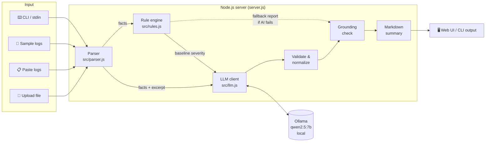
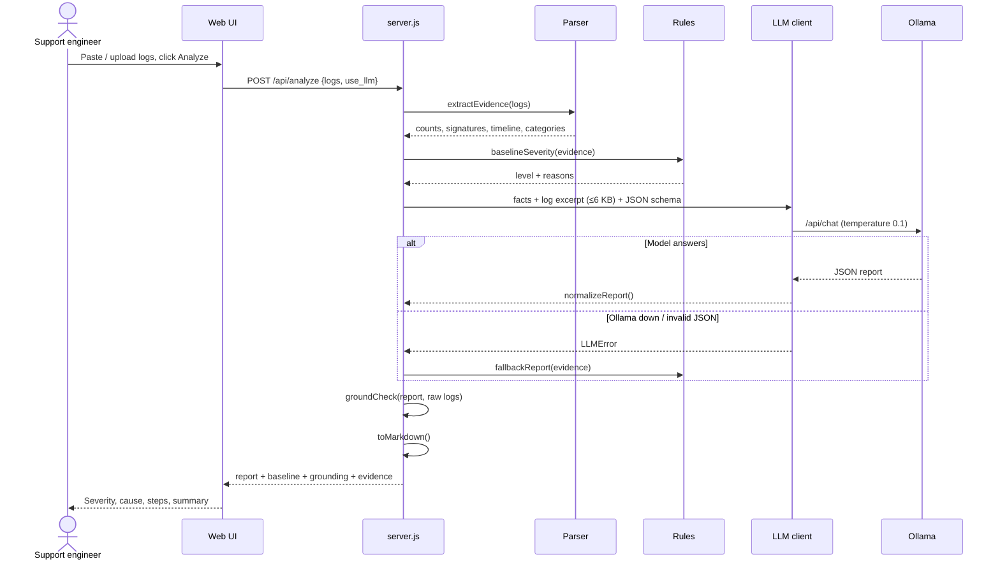
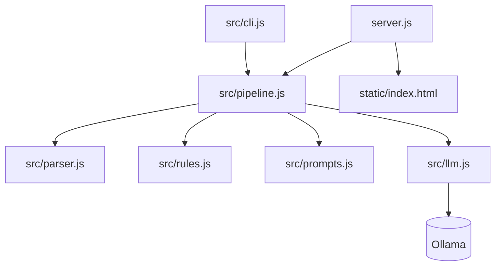
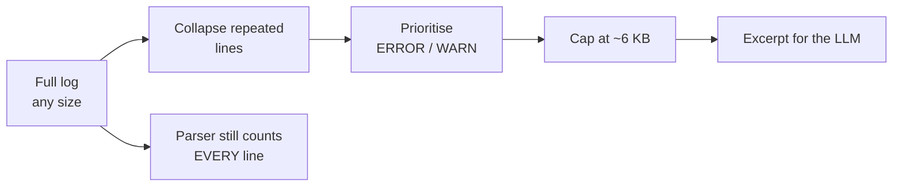
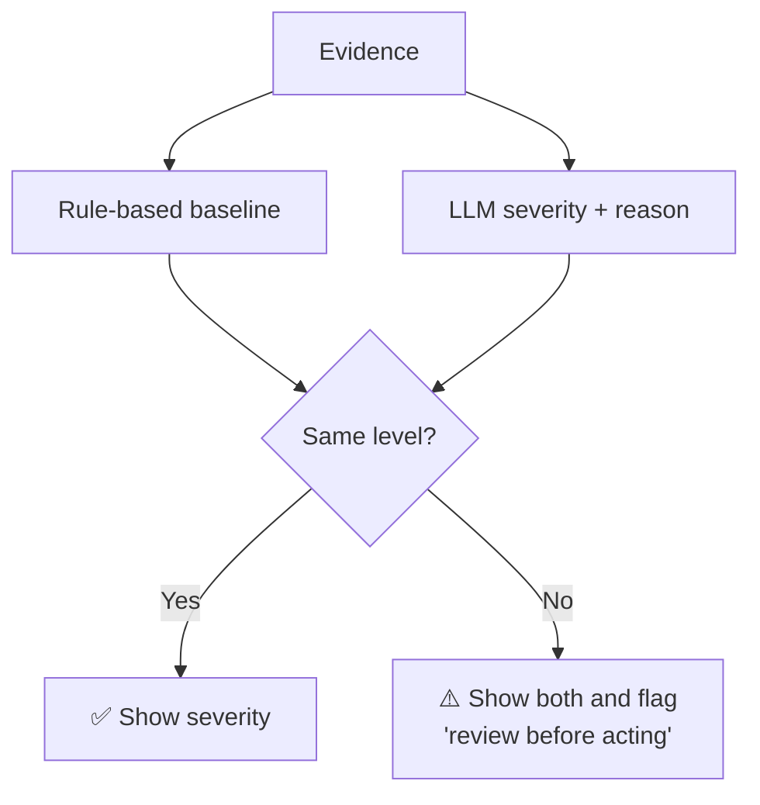
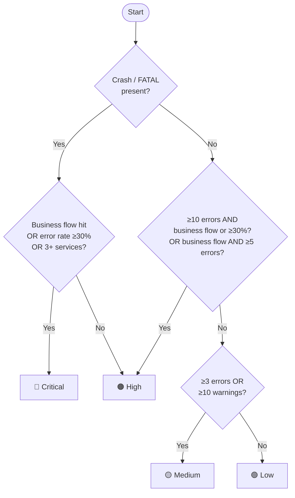
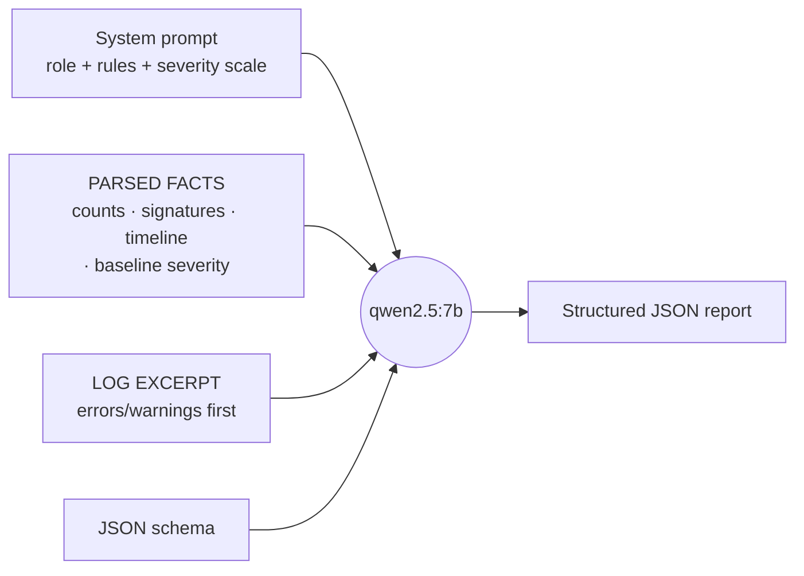
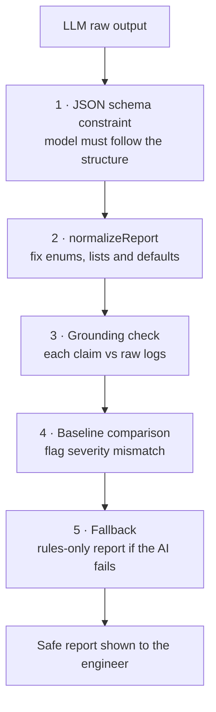
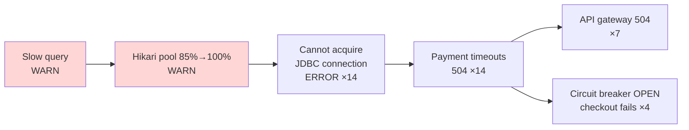

# 🔍 Incident Analyzer: AI-Powered Log Triage

> **Practical AI Assignment 1** (Technology Operations Intern)
> A prototype that reads application logs, works out what went wrong, rates how serious it is,
> and tells the support engineer what to check first and when to escalate.

| | |
|---|---|
| **Problem** | After an outage a support engineer has hundreds of log lines and has to find the cause quickly |
| **Solution** | Paste or upload logs → get key errors, a likely cause (evidence kept apart from assumptions), severity, next steps and a summary ready to share |
| **AI model** | `qwen2.5:7b`, running **locally** through Ollama (no log data leaves the machine) |
| **Tech stack** | Node.js 20+ with **zero npm dependencies** (`http`, `fetch`, `node:test`) |
| **Interfaces** | Web UI (`http://localhost:8000`) · CLI · JSON API |
| **Works offline / without AI?** | Yes. If the model is unavailable it falls back to a rule-based report |

---

## 📑 Contents

1. [Assignment requirements → how they're met](#1-assignment-requirements--how-theyre-met)
2. [Quick start](#2-quick-start)
3. [System architecture](#3-system-architecture)
4. [How one analysis flows (step by step)](#4-how-one-analysis-flows-step-by-step)
5. [Component breakdown](#5-component-breakdown)
6. [Log parsing and evidence extraction](#6-log-parsing-and-evidence-extraction)
7. [Severity classification](#7-severity-classification)
8. [The AI component](#8-the-ai-component)
9. [Hallucination guards](#9-hallucination-guards)
10. [Output: what the engineer sees](#10-output-what-the-engineer-sees)
11. [API reference](#11-api-reference)
12. [Testing](#12-testing)
13. [AI tools used and individual contribution](#13-ai-tools-used-and-individual-contribution)
14. [Assumptions](#14-assumptions)
15. [Limitations and future work](#15-limitations-and-future-work)
16. [Project structure](#16-project-structure)

---

## 1. Assignment requirements → how they're met

| # | Requirement (from the assignment) | How this project does it | Where in code |
|---|---|---|---|
| 1 | Accept logs by **upload or copy-paste** | Web UI has a file upload, a paste box and a "Load a sample" menu; the CLI reads a file or stdin | `static/index.html`, `src/cli.js` |
| 2 | **Summarize key errors**, find **patterns / repeated failures** | Parser normalizes messages into *signatures*, counts repeats, finds the error peak per minute | `src/parser.js` |
| 3 | **Likely cause**, with **evidence kept apart from assumptions** | The LLM must return separate `evidence[]` and `assumptions[]` lists; each evidence item is checked against the raw logs | `src/prompts.js`, `src/pipeline.js` |
| 4 | **Severity**: Critical / High / Medium / Low, with a reason | The LLM rating plus an independent rule-based baseline; the UI flags any disagreement | `src/rules.js`, `src/prompts.js` |
| 5 | **Troubleshooting steps** and **when to escalate** | 4–7 steps, *checks before fixes*, plus an escalation block (who and when) | `src/prompts.js`, `src/rules.js` |
| 6 | **Concise incident summary** to share with the team | Markdown summary ready for Slack, Teams or email (copy button in the UI) | `toMarkdown()` in `src/pipeline.js` |
| — | Sample or simulated data only | Four simulated incidents plus a generator script | `sample_logs/` |
| — | Don't present guesses as facts | Cause is labelled a *hypothesis* with a confidence level; claims not found in the logs are flagged | §9 |

---

## 2. Quick start

**Requirements:** Node.js 20+ and [Ollama](https://ollama.com). There are no npm dependencies, so there's nothing to `npm install`.

```bash
ollama pull qwen2.5:7b     # one-time download, ~4.7 GB
npm start                  # open http://localhost:8000
```

In the UI: **Load a sample…** (or upload/paste logs) → **Analyze logs**.
The pill in the header shows whether the model is ready. If it isn't, the tool still works using rules only.

### Command line

| Command | What it does |
|---|---|
| `node src/cli.js sample_logs/payment_db_outage.log` | Markdown incident report |
| `node src/cli.js sample_logs/payment_db_outage.log --json` | Full JSON result (report + evidence + metadata) |
| `node src/cli.js sample_logs/payment_db_outage.log --no-ai` | Rule-based analysis only (fast, no model) |
| `cat app.log \| node src/cli.js -` | Read logs from stdin |
| `npm test` | Run the 14 unit tests |
| `npm run samples` | Regenerate the sample logs |

### Configuration

| Env var | Default | Purpose |
|---|---|---|
| `OLLAMA_MODEL` | `qwen2.5:7b` | Any Ollama model, e.g. `llama3.1:8b` |
| `OLLAMA_HOST` | `http://localhost:11434` | Ollama endpoint |
| `OLLAMA_TIMEOUT` | `300` | Seconds to wait for the model |
| `PORT` | `8000` | Web server port |
| `HOST` | `127.0.0.1` (`0.0.0.0` on Render) | Address to listen on; set `0.0.0.0` on other cloud hosts |

---

## 3. System architecture

**Design principle: code handles the facts, the AI handles the reasoning.**
Small local models are bad at counting and tend to invent details, so every number comes from
deterministic code. The model only interprets those numbers.



### Why a hybrid (rules + AI) design?

| Approach | Strengths | Weaknesses |
|---|---|---|
| Rules only | Fast, predictable, never invents anything | Can't reason about cause and effect; keyword matching only |
| LLM only | Understands context and writes good explanations | Miscounts, invents details, output not guaranteed to be valid |
| **Hybrid (this project)** ✅ | Accurate facts **and** good reasoning; claims can be checked; still works without the AI | Slightly more code |

---

## 4. How one analysis flows (step by step)



| Step | Stage | Input | Output | Uses AI? |
|---|---|---|---|---|
| 1 | Input check | Raw text | Rejects empty or unrecognisable input | ❌ |
| 2 | Parse | Raw text | Structured entries (time, level, service, message) | ❌ |
| 3 | Extract evidence | Entries | Counts, signatures, categories, timeline | ❌ |
| 4 | Baseline severity | Evidence | Rule-based level + reasons | ❌ |
| 5 | Build prompt | Evidence + excerpt | Facts JSON + trimmed logs | ❌ |
| 6 | **Reason** | Prompt | Cause, severity, steps, summary (JSON) | ✅ |
| 7 | Normalize | Model JSON | Safe, well-formed report | ❌ |
| 8 | Grounding check | Report + raw logs | Each claim marked as found / not found | ❌ |
| 9 | Format | Report | Markdown summary to share | ❌ |

AI is used in **1 of 9 steps**. Everything else is deterministic and can be tested.

---

## 5. Component breakdown

| File | Role | Key functions | Lines |
|---|---|---|---|
| `server.js` | HTTP server: serves the UI and JSON API | `handle()` | ~110 |
| `static/index.html` | Single-page UI, no external libraries | — | ~585 |
| `src/parser.js` | Parses logs and extracts evidence | `parseLogs`, `extractEvidence`, `normalize`, `selectExcerpt` | ~275 |
| `src/rules.js` | Baseline severity and fallback playbook | `baselineSeverity`, `fallbackReport` | ~190 |
| `src/prompts.js` | System prompt and output JSON schema | `SYSTEM_PROMPT`, `OUTPUT_SCHEMA`, `buildUserPrompt` | ~60 |
| `src/llm.js` | Ollama client (built-in `fetch`) | `health`, `chatJson` | ~70 |
| `src/pipeline.js` | Orchestration, validation, grounding, Markdown | `analyze`, `normalizeReport`, `grounded`, `toMarkdown` | ~160 |
| `src/cli.js` | Command-line interface | — | ~25 |
| `tests/analyzer.test.js` | Unit tests | 14 tests | — |



---

## 6. Log parsing and evidence extraction

### Supported log formats

| Format | Example |
|---|---|
| Plain text | `2026-10-22 14:01:08,202 ERROR [payment-service] Unable to acquire JDBC Connection ...` |
| Key=value service | `2026-10-22T14:01:08Z WARN service=checkout Heap usage 92%` |
| JSON lines | `{"timestamp":"...","level":"warn","service":"notify","message":"SMTP retry succeeded"}` |
| Level keyword only | `ERROR something failed` |
| Stack traces | Lines starting with whitespace, `Traceback`, `Caused by:` or `... N more` are attached to the entry above |

### Signature normalization (grouping repeated errors)

Variable parts are replaced with placeholders, so the same error with different IDs counts as **one** repeated failure:

```
Before: POST /api/v1/payments txn=TXN-503461 failed ... timed out after 30000ms status=504
        POST /api/v1/payments txn=TXN-573933 failed ... timed out after 30000ms status=504
After:  POST /api/v1/payments txn=<ID> failed ... timed out after <N> status=<N>     (×14)
```

### Evidence the parser computes

| Evidence | Description | Why it matters |
|---|---|---|
| Level counts | INFO / WARN / ERROR / FATAL totals | Overall health |
| Error ratio | errors ÷ parsed entries | Feeds the severity rules |
| Services | Entries and errors per service | Shows how far the problem spread |
| Top signatures | Most frequent normalized errors, with first and last seen | Key errors |
| Repeated failures | Signatures seen 3+ times | Patterns |
| First-occurrence sequence | Signatures in order of first appearance | Separates the **trigger** from **knock-on symptoms** |
| Errors per minute | Peak error minute | When it got worst |
| Failure categories | Regex matches (table below) | Likely cause area |
| HTTP status codes | 4xx / 5xx counts | User impact |
| Business keywords | payment, checkout, order, login… | Is a critical flow affected? |
| Recovery signals | "succeeded", "recovered", "reconnected"… | Lowers severity |

### Failure categories detected

| Category | Matches (examples) | Fallback escalation target |
|---|---|---|
| `db_connection` | connection pool, HikariPool, JDBC, too many connections, deadlock | Database / DBA on-call |
| `timeout` | timed out, timeout, deadline exceeded | Owner of the slow dependency |
| `memory` | OutOfMemory, OOM, heap space, GC overhead | Application engineering |
| `crash` | fatal, panic, CrashLoop, exited with code, killed | Application engineering (on-call) |
| `upstream_5xx` | 502, 503, 504, bad gateway, service unavailable | Owner of the upstream service |
| `connection_refused` | ECONNREFUSED, connection reset, broken pipe | Platform / network |
| `circuit_breaker` | circuit breaker, circuit is open, fallback | Owner of the failing dependency |
| `disk` | no space left, disk full, inode | Infrastructure / SRE |
| `auth` | unauthorized, forbidden, token expired, 401, 403 | Identity / security |
| `rate_limit` | 429, rate limit, throttle | Owner of the rate-limited API |
| `tls` | certificate, SSL, TLS handshake, x509 | Platform / security |

### Excerpt selection (what the model actually reads)

A 7B model has a small context window, so the model doesn't get the whole file. It gets a **trimmed excerpt of at most ~6 KB**:



---

## 7. Severity classification

Severity is decided **twice**, independently. The two ratings are compared and the UI warns when they differ.



### Severity scale (shared by the AI prompt and the rules)

| Level | Meaning | Typical signals |
|---|---|---|
| 🔴 **Critical** | Outage: a business-critical flow is failing, a service is down or crash-looping, or data is at risk | Crash/FATAL **and** (payment/checkout affected, ≥30% error rate, or 3+ services) |
| 🟠 **High** | Major feature degraded or high error rate, but core flows mostly work | Crash alone, or ≥10 errors with a business flow or ≥30% error rate, or a business flow with ≥5 errors |
| 🟡 **Medium** | Intermittent errors or slowness; fallbacks and retries keep things working | ≥3 errors or ≥10 warnings |
| 🟢 **Low** | Isolated warnings or errors that recovered by themselves, no user impact | Anything below that |

### Rule-based baseline as a decision tree



---

## 8. The AI component

| Setting | Value | Why |
|---|---|---|
| Runtime | Ollama (local) | Log data never leaves the machine; free; works offline |
| Model | `qwen2.5:7b` | Reliable structured-JSON output; fits on a 16 GB laptop |
| Output format | Ollama `format` = **JSON schema** | The model can only answer in the expected structure |
| Temperature | `0.1` | Triage should be consistent, not creative |
| Context | `num_ctx: 8192` | Enough for the facts plus a ~6 KB excerpt |
| Timeout | 300 s (configurable) | Local inference can take a minute or more |

### What goes into the prompt



### Prompt rules and the problem each one solves

| Rule in the system prompt | Problem it prevents |
|---|---|
| Base every claim on the facts or excerpt; never invent services or errors | Hallucination |
| Evidence must cite a log message, timestamp or count; anything not shown in the logs is an **assumption** | Guesses presented as facts |
| "Don't claim a traffic spike unless request volume visibly rises" | The model inventing a "sudden spike in requests" (seen in the first prompt version) |
| State the cause as a **hypothesis** with High / Medium / Low confidence | Overconfidence |
| Use the first-occurrence sequence to separate trigger from symptoms | Blaming a symptom (e.g. 504s) instead of the trigger |
| Things happening in sequence **don't** prove causation | Forcing unrelated warnings into one story |
| Recovery signals lower severity | Over-rating incidents that recovered by themselves |
| Use the parser's counts; don't count yourself | Wrong numbers |
| Steps: **check and verify first**, then contain; no permanent config changes before the cause is confirmed | "Just raise the pool size" advice |
| Explain any disagreement with the baseline severity | Unexplained severity ratings |

### Output schema

| Field | Type | Content |
|---|---|---|
| `key_errors[]` | `{error, count, services[], significance}` | The most important errors |
| `patterns[]` | string[] | Repeated failures and trends |
| `likely_cause` | `{hypothesis, confidence, evidence[], assumptions[]}` | Cause, with evidence and assumptions kept separate |
| `contributing_factors[]` | string[] | Secondary factors |
| `impact` | string | Effect on users and business |
| `severity` | `{level, reason}` | Critical / High / Medium / Low |
| `troubleshooting_steps[]` | `{step, why}` | Ordered steps, checks first |
| `escalation` | `{required, to, when}` | Whether to escalate, to whom and when |
| `incident_summary` | string | 3–5 sentences ready for Slack |

---

## 9. Hallucination guards

Several layers protect against bad AI output:



| Layer | What it does | Catches |
|---|---|---|
| 1. JSON schema | Ollama limits generation to the schema | Free-text or wrongly shaped answers |
| 2. Normalization | Coerces types, clamps enums (e.g. `"critical"` → `Critical`, unknown → `Medium`) | Malformed fields that would break the UI |
| 3. Grounding check | ≥50% of a claim's distinctive words must appear in the logs, otherwise it's labelled **"not found in logs"** | Invented components, hosts or errors |
| 4. Baseline comparison | Rule-based severity is shown next to the AI's | AI over- or under-rating |
| 5. Fallback | Ollama down or invalid JSON → full rule-based report | Total AI failure |

---

## 10. Output: what the engineer sees

| UI section | Content |
|---|---|
| Severity badge | AI level + rule baseline (⚠️ if they differ) |
| Key errors | Signature, count, services, ✅/⚠️ grounded |
| Patterns | Repeated failures, error peak |
| Likely cause | Hypothesis + confidence · **Evidence** (with grounding marks) · **Assumptions** |
| Impact & contributing factors | Business and user effect |
| Troubleshooting steps | Numbered, each with a *why* |
| Escalation | Required? · to whom · when |
| Incident summary | Markdown with a copy button for Slack, Teams or email |
| Metadata | Model, duration, tokens, AI or rules source |

### Example shareable summary (`payment_db_outage.log`, rules mode)

```markdown
## Incident Summary — Severity: Critical

[Critical] 41 errors across 4 service(s) between 2026-10-22 14:00:06 and 2026-10-22 14:02:17.
Likely area: db_connection.

**Errors:** 41 / 65 entries (63%) · **Services:** payment-service, api-gateway, order-service, payment-db

### Key errors
- Unable to acquire JDBC Connection: HikariPool-<N> - Connection is not available ... (×14, payment-service)
- POST /api/v1/payments txn=<ID> failed: PaymentGatewayTimeoutException ... (×14, payment-service)
- upstream payment-service returned <N> Gateway Timeout ... (×7, api-gateway)

### Likely cause (hypothesis, confidence: Low)
Database connectivity problems (connection pool exhaustion, slow queries or DB unavailability).

**Evidence (from logs):** ...
**Assumptions (not confirmed):** ...
### Next steps
1. Start from the first error in the window ...
**Escalation:** Yes — Database / DBA on-call ...
```

---

## 11. API reference

| Method | Endpoint | Body / params | Response |
|---|---|---|---|
| `GET` | `/` | — | Web UI |
| `GET` | `/api/health` | — | `{ollama, model, model_ready, installed[], error}` |
| `GET` | `/api/samples` | — | `{samples: ["payment_db_outage.log", ...]}` |
| `GET` | `/api/samples/<name>` | file name | Raw sample log text |
| `POST` | `/api/analyze` | `{"logs": "...", "use_llm": true}` | `{report, baseline, grounding, evidence, meta, markdown}` |

| Status | When |
|---|---|
| `200` | Analysis complete (AI or rules fallback) |
| `400` | Empty input, no recognisable log lines, or invalid JSON |
| `413` | Body larger than 5 MB |
| `500` | Unexpected server error (the server stays up) |

---

## 12. Testing

### Unit tests: `npm test` (14 tests, all passing)

| Area | Test | What it checks |
|---|---|---|
| Parser | parses common formats | Plain, JSON-lines and level-only lines |
| Parser | stack trace lines attach to parent | Multi-line exceptions stay together |
| Parser | normalize groups variable parts | IDs, numbers and IPs → placeholders |
| Parser | repeated failures are counted | 3+ repeats are detected |
| Parser | recovery signals are detected | "succeeded" / "recovered" |
| Parser | excerpt respects budget and keeps errors | ≤6 KB, errors kept |
| Rules | `<sample> → <expected>` (×4) | Baseline severity for each sample |
| Pipeline | grounding flags invented claims | A made-up claim is marked "not found" |
| Pipeline | falls back to rules when Ollama is down | Simulated outage → rules report |
| Pipeline | malformed model output is normalized | Bad enums and types are fixed |
| Pipeline | rejects empty and unstructured input | Clear error messages |

### Scenario testing with the real model

Four simulated incidents in `sample_logs/` (regenerate with `npm run samples`):

| Sample | Simulated scenario | Expected | Rule baseline | AI (`qwen2.5:7b`) |
|---|---|---|---|---|
| `payment_db_outage.log` | Slow query → DB pool exhaustion → payment 504s → circuit breaker open | 🔴 Critical | Critical ✅ | Critical ✅ (12/12 items grounded) |
| `checkout_memory_leak.log` | Heap growth → OOM → CrashLoopBackOff → checkout 503s | 🔴 Critical | Critical ✅ | High ⚠️ (mismatch flagged in UI) |
| `cache_latency_degraded.log` | Redis latency and evictions; DB fallback working | 🟡 Medium | Medium ✅ | Medium ✅ |
| `minor_warnings.jsonl` | Deprecation warning, SMTP retry succeeded, missing template | 🟢 Low | Low ✅ | Low ✅ |

Example incident chain (payment DB outage), and what the tool should recognise:



<sub>Red = likely trigger; the rest are knock-on symptoms.</sub>

### Prompt iteration

| Version | Problem observed | Change made | Result |
|---|---|---|---|
| v1 | Claimed a "sudden spike in payment requests" with High confidence, which nothing in the logs supported | Added explicit evidence-vs-assumption rules (including "no traffic spike unless visible") | Spike claim gone |
| v1 | Recommended raising the pool size before any investigation | Added the "check / verify first, no permanent config changes before confirmed" rule | Steps now start with checks |
| v2 | Needed more context to tell the trigger apart from symptoms | Model now also receives `sequence_of_first_occurrence` and the rule baseline, plus a "timing ≠ causation" rule | 3 of 4 scenarios match the expected severity; the memory leak (AI: High, rules: Critical) is flagged in the UI |

---

## 13. AI tools used and individual contribution

| Purpose | Tool |
|---|---|
| Runtime model | `qwen2.5:7b` via Ollama (local), on a 16 GB MacBook Air M5 |
| Backend | Node.js 24 (built-ins only) |
| Development assistant | Claude Code (Anthropic) helped write code, prompts and tests; all output was reviewed and iterated against real model runs |

> **Individual contribution:** _fill in what you designed, decided and changed yourself, e.g. the
> choice of a hybrid rules + LLM architecture, prompt iterations, sample scenarios, and test cases._

---

## 14. Assumptions

| Area | Assumption |
|---|---|
| Log format | Text with a timestamp and/or level keyword, or JSON lines with `timestamp / level / service / message`-style keys |
| Services | Taken from `[brackets]`, `service=` keys or JSON fields; otherwise `unknown` |
| Business-critical flows | Detected by keywords: payment, checkout, order, transaction, billing, login, settlement |
| Data | All simulated; nothing connects to production systems |
| Scope | One batch of logs per analysis |

---

## 15. Limitations and future work

| Limitation | Effect | Possible improvement |
|---|---|---|
| A 7B model sometimes draws weak cause-and-effect links | Wrong cause story (e.g. unrelated warnings linked together) | Larger model, or a second "critic" pass |
| Grounding uses word overlap | Catches invented items, but can't verify the logic of a claim | Semantic or embedding-based matching, line-level citations |
| Speed: ~35–70 s per analysis | Slow for live triage | Smaller or quantized model, GPU, streaming output |
| Excerpt capped at ~6 KB | The model doesn't see every line (the parser still counts them all) | Chunked or map-reduce summarisation |
| Single batch, logs only | No correlation across uploads, metrics or traces | Combine with metrics, traces and deploy history |
| Heuristic thresholds and playbook | Not tuned on real incident data | Calibrate on historical incidents |

---

## 16. Project structure

```
pl-assignment/
├── server.js                 Web server (node:http): UI + JSON API
├── package.json              Scripts: start, test, analyze, samples
├── static/
│   └── index.html            Single-page UI (no external dependencies)
├── src/
│   ├── parser.js             Log parsing & evidence extraction
│   ├── rules.js              Baseline severity + rule-based fallback playbook
│   ├── prompts.js            System prompt + JSON output schema
│   ├── llm.js                Ollama client (built-in fetch)
│   ├── pipeline.js           Orchestration, validation, grounding, Markdown
│   └── cli.js                Command-line interface
├── sample_logs/
│   ├── generate-samples.js   Generator for the simulated incidents
│   ├── payment_db_outage.log
│   ├── checkout_memory_leak.log
│   ├── cache_latency_degraded.log
│   └── minor_warnings.jsonl
└── tests/
    └── analyzer.test.js      14 unit tests (node:test)
```
