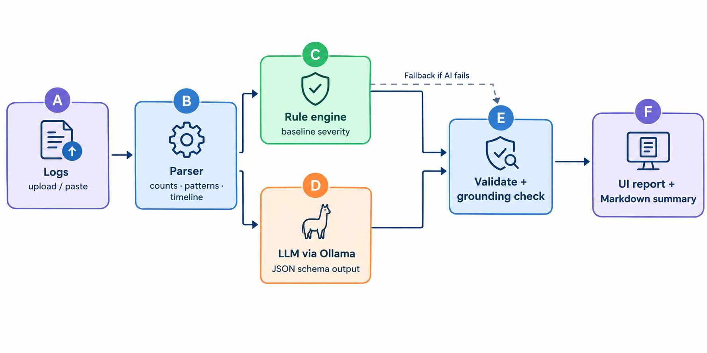
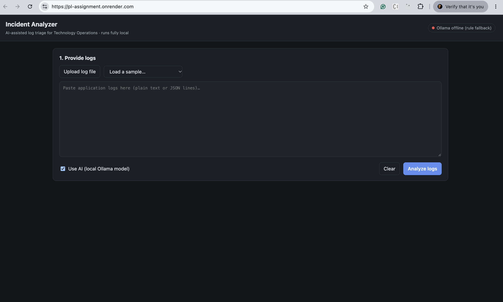
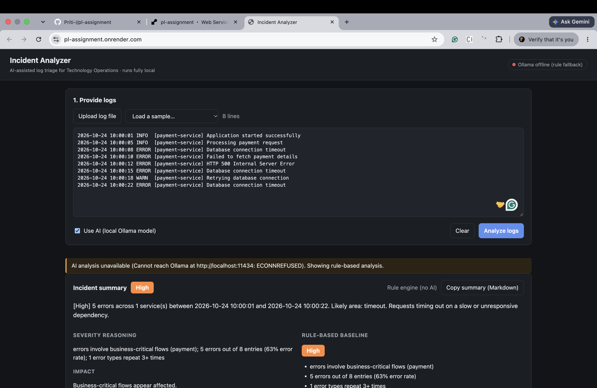
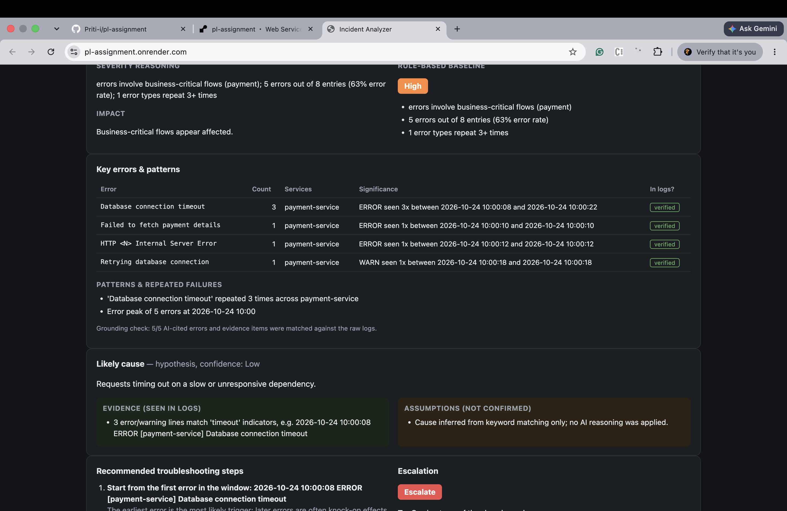
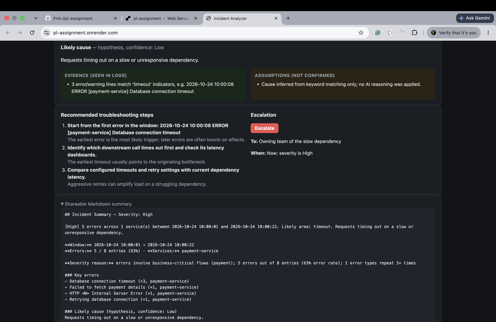
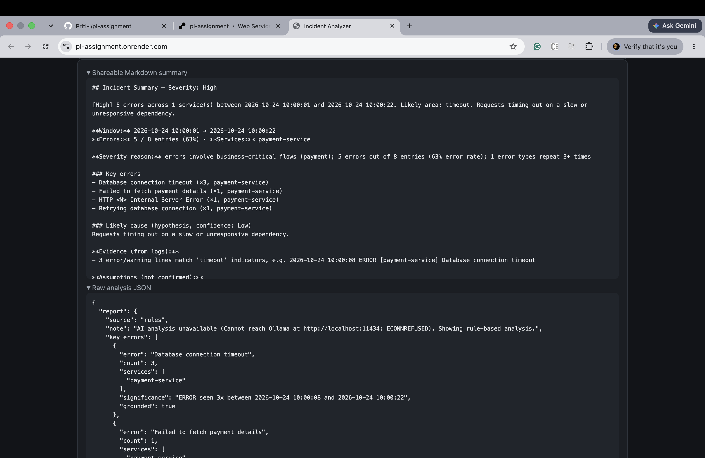

# Incident Analyzer: AI-Powered Log Triage

An AI-assisted log triage prototype for Technology Operations and L1/L2 support engineers. It parses application logs, detects recurring errors, estimates severity, suggests likely causes, and provides troubleshooting and escalation guidance.

> **Live demo:** https://pl-assignment.onrender.com  
> **Source code:** https://github.com/Priti-i/pl-assignment

**Deployment note:** The hosted Render version does not have access to a local Ollama instance, so it uses rule-based analysis when Ollama is unavailable. AI-powered analysis is intended for a local setup where Ollama is running.

## Quick Start

```bash
ollama pull qwen2.5:7b     # one-time download; approximately 4.7 GB
npm start                  # open http://localhost:8000
npm test                   # run the automated tests
node src/cli.js sample_logs/payment_db_outage.log
node src/cli.js sample_logs/payment_db_outage.log --no-ai
```

Requirements: Node.js 20+; install Ollama locally for AI-powered analysis. The project uses Node.js built-in modules and does not require third-party npm packages according to the current project setup.

## Problem Statement

When an application fails, support engineers may need to read many log lines to identify errors, understand impact, and decide what to investigate next. Manual analysis can take time.

This prototype accepts application logs and generates a structured incident report containing key errors, recurring patterns, a likely-cause hypothesis, severity, troubleshooting steps, and escalation guidance.

**Goal:** Help engineers triage incidents faster while keeping the distinction between log evidence and unconfirmed assumptions visible.

## Technology Stack

- **Runtime:** Node.js 20+
- **Server:** Node.js built-in `http` module
- **AI runtime:** Ollama
- **Default model:** `qwen2.5:7b`
- **Testing:** Node.js built-in test runner (`node:test`)
- **Version control and hosting:** Git and GitHub
- **Deployment:** Render

## AI Tools and Models Used

### Runtime AI Model — Qwen 2.5 (7B) via Ollama

The project uses Qwen 2.5 (7B) through Ollama, with a temperature of `0.1` and JSON-schema output to generate structured log analysis. The model is intended to run locally on a 16 GB laptop, helping keep logs on the machine when both the application and Ollama run locally.

### Development Assistant — Claude Code (Anthropic)

Claude Code assisted with writing application code, designing prompts, and creating tests. Generated output was reviewed and refined based on actual model runs.

## How It Works

1. **Input:** The user pastes logs, uploads a log file, or selects sample logs.
2. **Parsing — `src/parser.js`:** Reads plain-text and JSON logs, groups repeated errors into signatures, masks IDs and numbers where applicable, and counts errors by service, minute, and failure type.
3. **Rule engine — `src/rules.js`:** Calculates a transparent baseline severity from the extracted evidence and can provide a fallback report if AI analysis is unavailable.
4. **AI analysis — `src/llm.js` and `src/prompts.js`:** Sends parsed facts and a log excerpt of at most 6 KB to the Ollama model. The model is instructed to return structured JSON with separate evidence and assumptions, a root-cause hypothesis, and checks to perform before fixes.
5. **Validation — `src/pipeline.js`:** Normalizes malformed output where possible, checks cited errors and evidence against the raw logs, labels unmatched items as **“not found in logs”**, and flags disagreement between AI severity and the rule-based baseline.
6. **Report:** Displays the incident summary, key errors, patterns, likely cause, troubleshooting steps, escalation guidance, and a shareable Markdown summary.

## Architecture



The parser feeds both the rule engine and the AI model. Their results are validated before being shown in the report. If AI analysis fails, the rule engine can provide the fallback report.

## Screenshots

These screenshots are from the live Render deployment. Ollama isn't available there, so the results come from the rule-based fallback. Running locally with Ollama produces the same layout with AI-generated analysis.

### 1. Home screen: provide logs

Upload a log file, load a sample, or paste logs. The pill in the top-right shows whether the AI model is available.



### 2. Incident summary and severity

After you click **Analyze logs**, the report opens with the severity badge, a one-line summary, the reasoning behind the severity, the impact, and the rule-based baseline for comparison.



### 3. Key errors, patterns and likely cause

Repeated errors are grouped with counts, services and time ranges. Each one is marked **verified** when it is found in the raw logs. The likely cause is shown as a hypothesis, with **Evidence (seen in logs)** kept separate from **Assumptions (not confirmed)**.



### 4. Troubleshooting steps and escalation

Steps are ordered with checks first, and each step says why it matters. The escalation panel shows whether to escalate, to whom, and when.



### 5. Shareable summary and raw JSON

A Markdown summary ready to paste into Slack, Teams or email, plus the full analysis as JSON for debugging.



## Testing

Testing should cover the parser, rule engine, AI response handling, grounding checks, fallback behavior, and user input validation.

Suggested scenarios:

- Database connection timeout
- Repeated HTTP 500 errors
- Out-of-memory errors
- HTTP 401/403 authentication failures
- Repeated error signatures
- Empty or malformed input
- Ollama unavailable, to verify the rule-based fallback
- AI evidence that cannot be matched to the raw logs
- Difference between AI severity and the rule-based baseline

Run the automated tests with:

```bash
npm test
```

The project is expected to have 14 unit tests according to the current project notes. Confirm the output from `npm test` before reporting the final test result; do not mark a scenario as passed unless it has been verified.

## Limitations

- The 7B model may associate unrelated events. Grounding checks and the baseline help make this visible but do not guarantee correct reasoning.
- The grounding check uses word overlap; it can flag unmatched items but cannot prove that a conclusion is logically correct.
- Local AI analysis may take approximately 35–70 seconds, depending on the machine and model load.
- The model receives a log excerpt of at most 6 KB, although the parser can count entries across the input.
- The prototype analyzes one log batch at a time and does not correlate logs with metrics, traces, or other uploads.
- Severity thresholds and troubleshooting guidance are heuristic and have not been tuned against a labelled production-incident dataset.
- The hosted Render deployment does not have a local Ollama service available and therefore uses rule-based analysis when AI is unreachable.

## Responsible Use

Treat the suggested root cause as a hypothesis, not a confirmed diagnosis. Verify evidence and troubleshooting steps before taking action. Do not submit passwords, access tokens, personal information, or confidential production logs unless the environment's data-handling and security arrangements have been approved.
